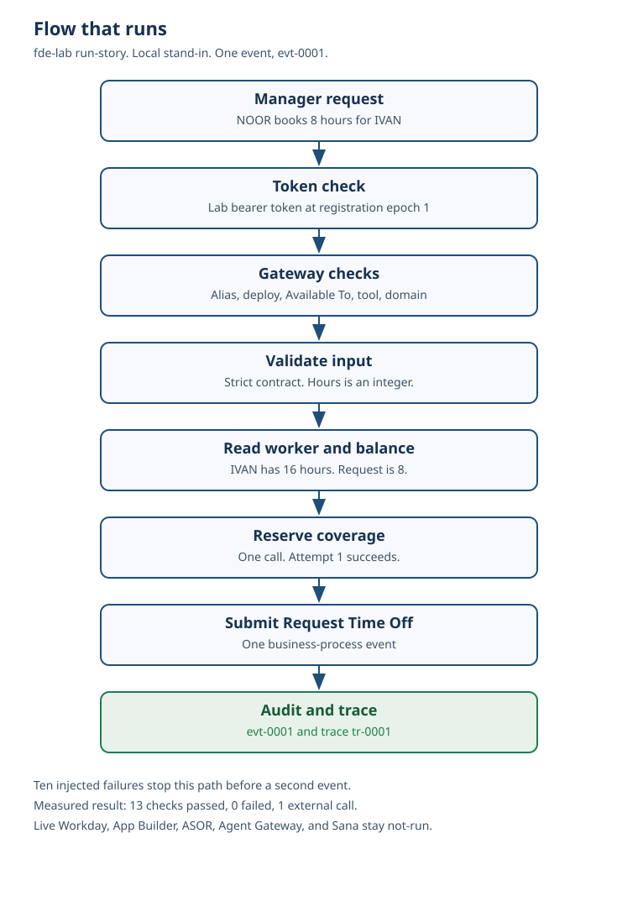

# Workday FDE Agent Deployment Lab

Forward-deployed lab for a Workday custom agent. The local command `fde-lab run-story` runs. It submits one Request Time Off event, writes the audit row, and then injects ten failures on that same path.



The committed trace for that run is `token_check`, five `gateway_authorize` checks, `validate_input`, `read_worker`, `read_balance`, `reserve_coverage`, and `submit_business_process`. The audit row is `evt-0001`. The trace is `tr-0001`. One coverage call. Tokens are 0. No price is applied.

This is not a Workday tenant, not an App Hub deployment, and not a Sana agent. No live Workday call was made. No model was called.

## Engagement

The package is a synthetic engagement, SYN-ORG-NORTHLINE. The people are SYN-USER-NOOR (manager), SYN-USER-IVAN (worker in that chain), SYN-USER-HANA (HR partner), and SYN-USER-OTTO (worker outside NOOR's chain). They are not a customer, and this repository is not evidence that anyone installed or used the agent.

The agent `time-off-coverage` is delegate-only. `read-balance` may be used by the manager and the HR partner. `request-coverage` may be used by the manager, and only for a worker in that manager's chain. It reads the worker, checks the balance, reserves a lab coverage slot, and submits one Request Time Off business-process event per `client_request_id`.

## What runs here

| Piece | In this repo |
| --- | --- |
| `.agent` and `.agentskill` files | `agent/time-off-coverage/` |
| ASOR v1.2 body builder and local POST/GET stand-in | `src/fde_lab/asor.py` |
| Security groups, ASU, Available To, domain policies | `agent/time-off-coverage/security/groups.yaml` |
| Custom Agent Action orchestration | `agent/time-off-coverage/orchestrations/request-coverage.json` |
| Agent Gateway check order, MCP client, action client | `src/fde_lab/gateway.py`, `src/fde_lab/runtime.py` |
| Timeout, retry, idempotency | `src/fde_lab/orchestrate.py` |
| Traces with secrets removed | `src/fde_lab/tokens.py` |
| Prompt-tool fix reused as a preflight check | `src/fde_lab/prompts.py` |
| Troubleshooting suite | `fde-lab run-suite` |
| Field story: one write, ten injected failures, backlog FDE-BACKLOG-001 | `fde-lab run-story` |

Workday's custom-agent page says the runtime routes every call through one of four clients and then names two: the MCP client for Agent Gateway, and the Custom Agent Actions client for Orchestrate. This lab implements those two and refuses a direct API call. It does not invent the other two.

## What was not run

| Gate | Status |
| --- | --- |
| Development tenant | not-run |
| App Builder deploy to App Hub | not-run |
| Live `POST /asor/v1/agentDefinition` | not-run |
| Live Agent Gateway MCP | not-run |
| Sana | not-run |
| Orchestration Builder export | not-run |
| Local Docker build | not-run |
| Hosted model | not-run |

A personal development tenant is requested from the Workday Developer Site Console, under Tenants. Workday's current personal-account page says a developer can request one development tenant, the tenant expires after 7 days without a login, and the first sign-in uses the user name `lmcneil`. No tenant was requested for this lab. If `WORKDAY_TENANT_ALIAS` and `WORKDAY_ACCESS_TOKEN` are set, the gate stays blocked and the token is not sent.

## Measured suite

Workstation run of `fde-lab run-suite` against the local stand-in. The committed copy is `reports/suite_results.md`. Duration is this process only. It is not a latency gate and it is not copied from another repository.

| Field | Value |
| --- | --- |
| Cases | 34 |
| Passed | 34 |
| Failed | 0 |
| Token leak count | 0 |
| Business-process events after the replay | 1 |
| External coverage calls after the replay | 1 |
| Suite duration | 3.3394 ms on this workstation for the committed report. Not a regression gate. |

The replay case submits Request Time Off once. The second call with the same `client_request_id` returns that event and does not reserve coverage again.

## Measured field story

Workstation run of `fde-lab run-story`. The committed copy is `reports/field_story.md`. Duration is this process only. It is not a latency gate.

| Field | Value |
| --- | --- |
| Checks | 13 |
| Passed | 13 |
| Failed | 0 |
| Happy-path event | evt-0001 |
| External coverage calls on the happy path | 1 |
| Tokens | 0 |
| Hosted model | not-run |
| Story duration | 203.4542 ms on this workstation for the committed report. Not a regression gate. |

The story submits one Request Time Off event for SYN-USER-NOOR booking 8 hours for SYN-USER-IVAN, then reproduces ten failures. Each row has a symptom, telemetry, diagnosis, root cause, fix, validation, and prevention. The prompt-tool omission is backlog FDE-BACKLOG-001.

Pytest on this machine: 15 passed, branch coverage 83.00%. Ruff and mypy strict were clean. A local Docker build was not run. Docker is not installed here. The image build is the `docker-build` job in GitHub Actions.

## Layout

```
agent/time-off-coverage/     .agent, .agentskill, security, orchestration
agent/agent_definition/      index of that agent file
agent/skills/                index of the skill files
agent/prompts/               prompt WID template
agent/policies/              delegate-mode template
failure_scenarios/           ten injected failures
security/                    role and permission templates
workflows/                   time-off steps, approval rule, coverage call
services/                    API routes, integration, Workday boundary, telemetry fields
fixtures/                    lab catalog and synthetic workers
src/fde_lab/                 package checks, runtime, suite, story, API
docs/                        discovery, spec, friction, runbook, ADRs, backlog
reports/                     measured suite and field story
```

## Commands

```powershell
py -3.12 -m venv .venv
.\.venv\Scripts\python.exe -m pip install -e ".[dev]"
.\.venv\Scripts\python.exe -m fde_lab.cli preflight
.\.venv\Scripts\python.exe -m fde_lab.cli run-suite
.\.venv\Scripts\python.exe -m fde_lab.cli run-story
.\.venv\Scripts\python.exe -m pytest
.\.venv\Scripts\python.exe -m fde_lab.cli serve --host 127.0.0.1 --port 8000
```

`GET /health` reports the gates. `POST /invoke` runs one skill. `POST /asor/agentDefinition` is the local stand-in and requires `wd-agent-tenant-alias`. It does not call `us.agent.workday.com`.

## Documents

- [Customer discovery](docs/customer-discovery.md)
- [Integration specification](docs/integration-spec.md)
- [Security model](docs/security-model.md)
- [Field friction](docs/field-friction.md)
- [Field friction analysis](docs/field-friction-analysis.md)
- [Troubleshooting runbook](docs/troubleshooting-runbook.md)
- [Root-cause runbook](docs/runbooks/rca.md)
- [Deployment checklist](docs/checklists/deployment.md)
- [Security checklist](docs/checklists/security.md)
- [Production readiness](docs/production-readiness.md)
- [Prompt-tool capability](docs/capabilities/prompt-tools.md)
- [Backlog FDE-BACKLOG-001](docs/backlog/FDE-BACKLOG-001.md)
- [Gates](docs/gates.md)
- [Architecture](docs/architecture.md)

## Production decision

NO-GO. The checks that can run without a tenant pass. Registration, activation, security-policy activation, and a real business process were not executed in Workday.

## License

MIT, 2026, Jatinder Singh.
