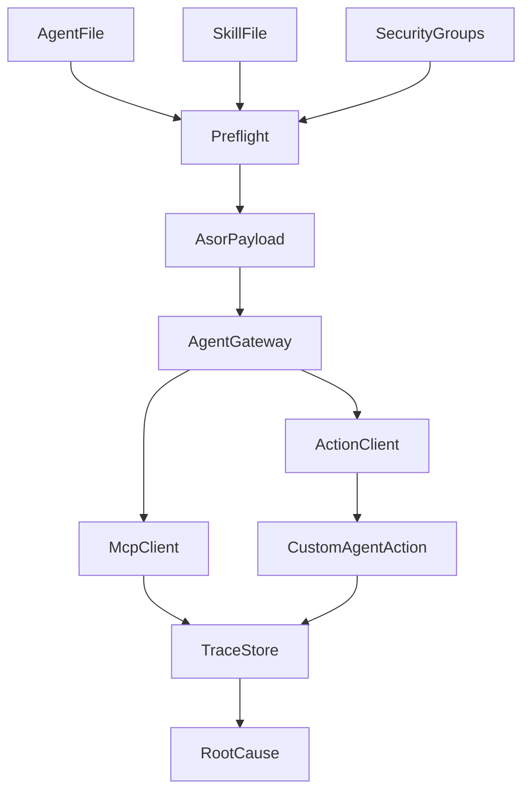
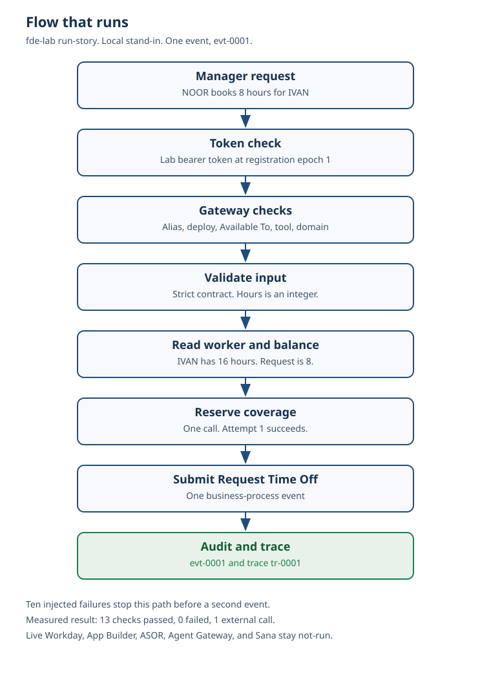
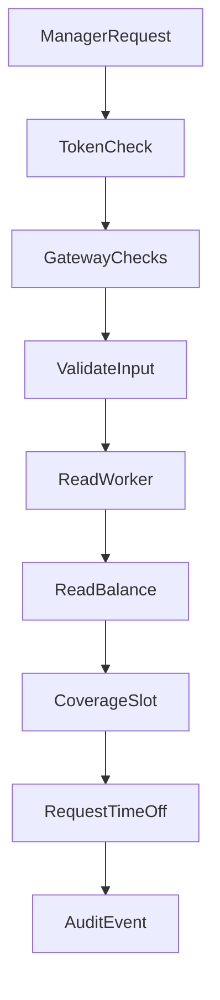

# Architecture

The lab loads one Agent app package, checks it, and runs a scripted invocation. It does not call a model, and it does not call Workday.

## Clients

A direct Workday URL is rejected with `direct_api_blocked`. Reads go through the MCP client. The coverage write goes through the Custom Agent Action client. Both clients pass the Agent Gateway checks first:

1. Tenant alias present.
2. Token valid, and issued at the current registration epoch.
3. App version deployed.
4. Skill enabled.
5. Actor in Available To. If not, the tool is not listed.
6. Tool name registered. Otherwise `Unknown tool`.
7. WID present, including required prompt-tool WIDs.
8. Actor's groups intersect the domain policy.
9. Protocol fault, when the suite injects REST 403 or SOAP 401.

## Registration

`build_registration` emits an ASOR v1.2 body: `Provider=SELF-BUILT`, `Platform=OTHER`, `Mode=Delegate`, and one `workdayConfig` row per skill. The coverage skill also lists the lab coverage URL with no `agent_resource`, matching the published shape for a non-Workday tool. The URL host is `lab.invalid`. The local `AsorService` stores that body in memory. A second POST with the same name, provider, and version updates the same record and bumps the registration epoch so an older token becomes stale.

## Action

`requestTimeOffCoverage` is 22 characters, under the documented 30-character Custom Agent Action limit. The effect annotation is `Idempotent`. The lab store is what makes the replay return the same Request Time Off event. That store dies with the process. It is not an Orchestration Builder export.

## Field story

`fde-lab run-story` runs one manager request and ten injected failures. The request is a pydantic contract. No model is called. Authorization and the business-process permission check happen before the coverage call. The Request Time Off row is written only after coverage succeeds. The measured chain is `reports/field_story.md`. The same diagram is attached to the README.

## Traces

Each invoke stores a trace of nodes with inputs and outputs. Bearer values and `lab-token-` secrets are removed before the node is stored. The lab does not write App Hub traces and does not create an `AviatoTurboChatCIS` node, because no model call is made. Workday's trace page says that node is where the model call appears, and that traces are kept for 30 days for Extend Professionals. Neither of those behaviors is claimed here.
